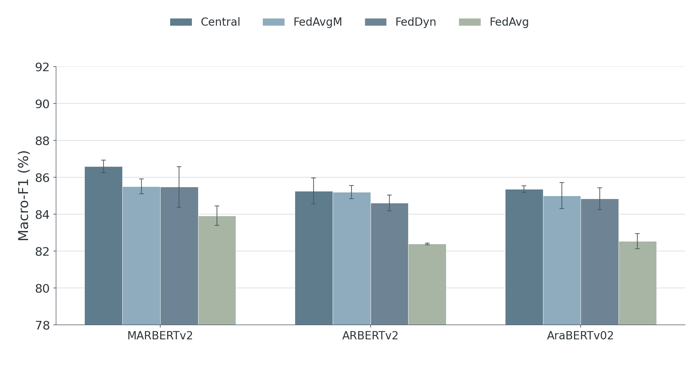
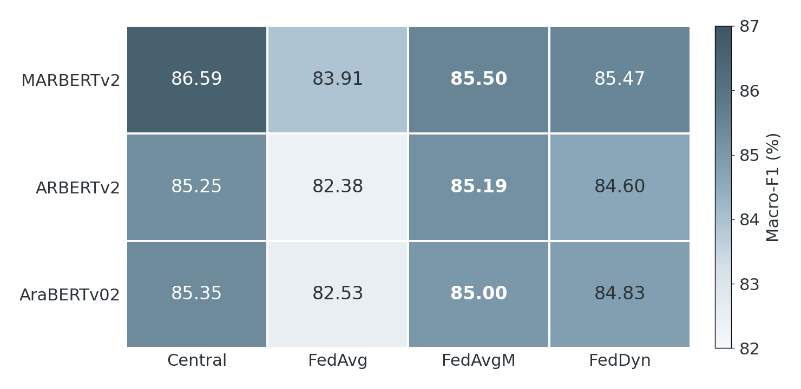
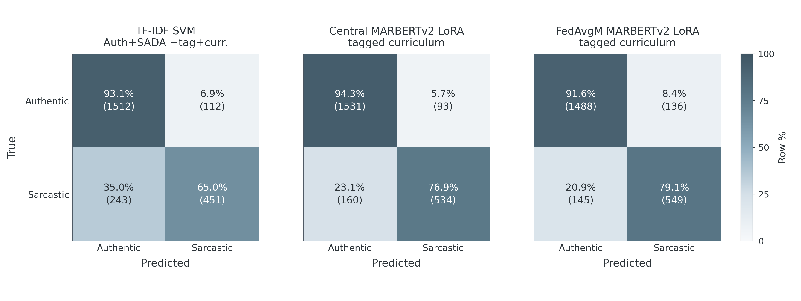
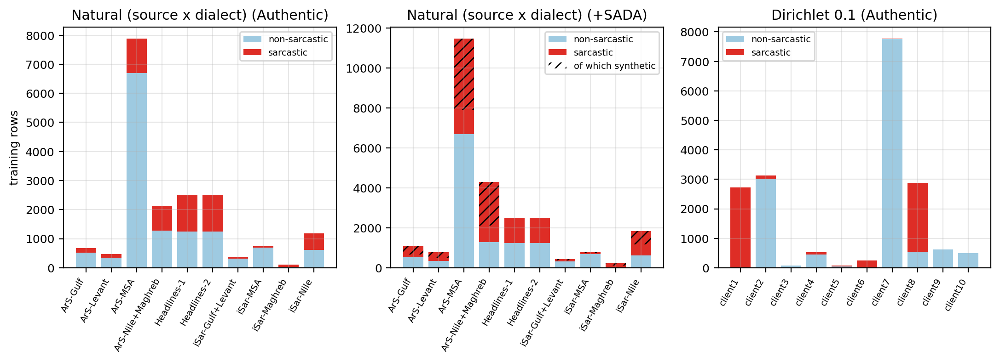
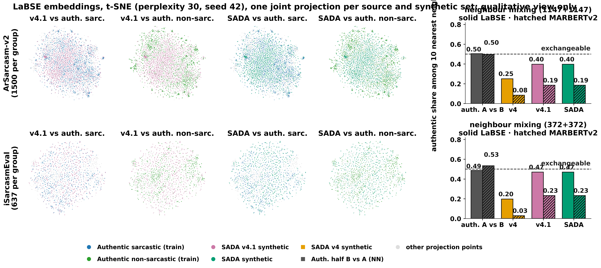

# FDL-ASD

**Remote:** [https://github.com/AlaaRahma/FDL_ASD](https://github.com/AlaaRahma/FDL_ASD)  
**SADA data:** [https://github.com/AlaaRahma/SADA_Generation](https://github.com/AlaaRahma/SADA_Generation)

Federated deep learning for **Arabic sarcasm detection**. This repo is the reproducible code companion to the FDL-ASD paper: authentic Arabic sarcasm splits, optional **SADA** synthetic training add-on, and modular central / federated training.

## Models (Hugging Face / GitHub)

Identifiers match `src/flasd/common.py` and the paper’s SADA/encoder table:

| Role | Model | Hugging Face | GitHub |
|---|---|---|---|
| FL / gate encoder | MARBERTv2 | https://huggingface.co/UBC-NLP/MARBERTv2 | https://github.com/UBC-NLP/marbert |
| FL / gate encoder | ARBERTv2 | https://huggingface.co/UBC-NLP/ARBERTv2 | https://github.com/UBC-NLP/marbert |
| FL / gate encoder | AraBERTv02 | https://huggingface.co/aubmindlab/bert-base-arabertv02 | https://github.com/aub-mind/arabert |
| SADA generator / teachers | ALLaM-7B-Instruct-preview | https://huggingface.co/humain-ai/ALLaM-7B-Instruct-preview | — |
| Second verification | Fanar-1-9B-Instruct | https://huggingface.co/QCRI/Fanar-1-9B-Instruct | — |
| Semantic diversity | LaBSE | https://huggingface.co/sentence-transformers/LaBSE | https://github.com/facebookresearch/LaBSE |

## Overview

Arabic sarcasm is hard to detect and even harder to share: labelled posts often sit behind privacy or platform constraints. **FDL-ASD** studies how to train sarcasm detectors in a *federated* setting—clients keep their data local—while still matching strong centralised baselines.

Instead of shipping full model updates, the recipe leans on **LoRA** (and related efficient adapters) so clients adapt large Arabic encoders with small, shareable updates. Where authentic sarcastic training text is scarce, the paper adds **SADA**: a curated set of **4,229** synthetic sarcastic tweets used only for training (validation and test stay fully authentic).

The practical training recipe is simple: mark synthetic rows with source tags, use soft teacher labels, and favour an authentic-first curriculum. Comparisons stay fair by holding the same authentic splits and reporting the same metrics against classical and deep baselines.

## What you get

| Piece | Path |
|---|---|
| Package | `src/flasd/` |
| Authentic splits | `data/authentic/` — **18,548 / 2,318 / 2,318** (train / val / test) |
| SADA (optional) | `data/sada/sada.csv` — **4,229** synthetic sarcastic tweets |
| Run CLIs | `scripts/run.py`, `scripts/classic.py` |
| Comparison figures | `docs/figures/` |
| Example result JSON | `results/examples/` |

Validation and test stay authentic. SADA is training-only.

## Layout

```
FDL-ASD/
├── configs/           # optional YAML snippets
├── data/
│   ├── authentic/     # paper authentic splits
│   └── sada/          # SADA CSVs + short README
├── docs/figures/      # FL comparison + SADA validation plots
├── results/examples/
├── scripts/           # run.py · classic.py · smoke_check.py
└── src/flasd/         # data · models · train · eval · fl · classic · …
```

## Setup

Python 3.10+ recommended. From this directory:

```bash
python -m venv .venv && source .venv/bin/activate
pip install -r requirements.txt
export PYTHONPATH="$PWD/src${PYTHONPATH:+:$PYTHONPATH}"
```

GPU is optional for the data smoke check; LoRA / full fine-tuning wants a CUDA GPU. QLoRA needs `bitsandbytes`.

Quick integrity check (no training):

```bash
python scripts/smoke_check.py --quick   # row counts + CLI --help (no torch needed)
python scripts/smoke_check.py           # also imports torch / models / FL modules
```

## Data protocol (matches the paper)

| Set | Rows | Notes |
|---|---:|---|
| Authentic train | 18,548 | Real posts only — **not** mixed with the older 7,390 pool |
| Authentic val / test | 2,318 each | Held out for selection / reporting |
| **SADA** | **4,229** | Synthetic sarcastic add-on → `data/sada/sada.csv` |
| Train with SADA | 22,777 | Authentic + SADA |

CLI / API data names:

- `auth` — authentic train only  
- `sada` (alias `sadac`) — authentic + SADA  
- `ros` — oversampling baseline matched to SADA strata  

See `data/sada/README.md` for dialect / source tables and validation figures.

## Run

Centralised LoRA on authentic data:

```bash
python scripts/run.py --setting central --model MARBERTv2 --mode lora \
  --data auth --seed 42 --out results/central_auth_seed42
```

Federated FedAvg with SADA + paper-style P2 helpers (source tags, `[SYN]`, soft labels, λ_syn = 0.3):

```bash
python scripts/run.py --setting fl --algo fedavg --partition natural --clients 10 \
  --model MARBERTv2 --mode lora --data sada --p2 --seed 42 \
  --out results/fedavg_sada_p2_seed42
```

TF-IDF baselines (CPU):

```bash
python scripts/classic.py --data auth --methods svm,lr,cnb
```

Useful flags on `run.py`: `--tag`, `--syn-marker`, `--synthetic-scale 0.3`, `--teacher-logits data/sada/sada_teacher_pens.csv`, `--max-train N` (smoke subsample), `--help`.

## Comparison figures

A few paper-side plots live under `docs/figures/` for orientation:









SADA embedding / fidelity checks (same assets as the SADA package):



## Package map

| Module | Role |
|---|---|
| `flasd.data` | Splits, tags, soft labels, client partitions |
| `flasd.models` | MARBERTv2 / ARBERTv2 / AraBERTv02 / MARBERT · full / LoRA / QLoRA |
| `flasd.train` / `eval` | Local loop, metrics, inference |
| `flasd.fl` | FedAvg, FedProx, SCAFFOLD, FedAvgM, FedDyn, … |
| `flasd.classic` | TF-IDF SVM / LR / CNB (+ BiLSTM) |
| `flasd.privacy` / `stats` | MIA helpers, paired bootstrap |

## Paper

This repo is the code companion to:

> Alaa Rahma, Ammar Mohammed, Wael Issa, and Shahira Shaaban Azab.  
> **FDL-ASD: Leveraging Federated Deep Learning for Arabic Sarcasm Detection.**  
> *SN Computer Science* (Springer) — **under review**.

The optional synthetic training set (**SADA**, 4,229 sarcastic tweets) and generation artefacts are released separately as [SADA_Generation](https://github.com/AlaaRahma/SADA_Generation). A local mirror of the CSVs also lives under `data/sada/` in this repo. If you use the code or SADA, please cite the paper above.
